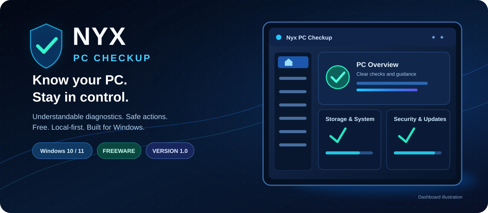

  

  
  
  
  

<h1 align="center">Nyx PC Checkup 1.0.0</h1>

  <strong>Know your PC. Stay in control.</strong> 
  Straightforward Windows health checks, understandable recommendations, and safe actions you choose.
   <strong>By Dietrich AI Labs.</strong>

  <a href="https://www.dietrichailabs.com/downloads/nyx-pc-checkup/1.0.0/Nyx_PC_Checkup_1.0.0_Setup.exe"><strong>⬇ Download Windows Installer</strong></a>
  &nbsp;&nbsp;•&nbsp;&nbsp;
  <a href="https://www.dietrichailabs.com/downloads/nyx-pc-checkup/1.0.0/Nyx_PC_Checkup_1.0.0_Portable.zip"><strong>⬇ Download Portable ZIP</strong></a>
  &nbsp;&nbsp;•&nbsp;&nbsp;
  <a href="https://www.dietrichailabs.com/apps/nyx-pc-checkup/"><strong>Official Product Page</strong></a>

  Windows 10/11 • 64-bit • Freeware • No account or product key required

---

## What is Nyx PC Checkup?

Nyx PC Checkup is a **free, local-first Windows PC diagnostic and maintenance utility**. It checks common aspects of your computer and explains what it found, why it matters, and whether you actually need to do anything. Scanning itself is **read-only**—no automatic fixes or deletion.

| Feature | What you get |
|---|---|
| **Quick & Full Check** | Scan progress, plain-language results, and the ability to stop a scan. |
| **System & Storage** | Drive space, supported folder information, uptime, network and performance snapshots. |
| **Security & Updates** | Windows protection/update indicators and links to the official Windows controls. |
| **Startup Apps** | Inspect startup entries; explicitly disable or re-enable supported **current-user** items with recovery records. |
| **Backup & Installed Apps** | Detectable Windows backup signals and a searchable application list. |
| **Safe Cleanup** | Review candidate files, select items yourself, read the consequences and confirm first. |
| **Diagnostic Exports** | Save redacted reports as **TXT, JSON or PDF**. |
| **Appearance & Updates** | Light, Dark and Follow Windows themes; optional **update-availability** checks (no automatic installs). |

### What the results mean

| Result | Meaning |
|---|---|
| **Good** | No meaningful problem detected by that particular check. |
| **Needs Attention** | Something worth reviewing or addressing. |
| **Optional** | A choice that might improve convenience or free space; not an emergency. |
| **Unknown / Could Not Check** | Windows did not provide enough reliable information. **It doesn't automatically mean the PC is broken.** |

## Download and get started

| Package | Recommended for | Download |
|---|---|---|
| **Windows Installer** | Normal installation, Start menu entry and uninstall support. | **[Get Setup.exe](https://www.dietrichailabs.com/downloads/nyx-pc-checkup/1.0.0/Nyx_PC_Checkup_1.0.0_Setup.exe)** |
| **Portable ZIP** | Extracting the full app into your chosen folder. | **[Get Portable ZIP](https://www.dietrichailabs.com/downloads/nyx-pc-checkup/1.0.0/Nyx_PC_Checkup_1.0.0_Portable.zip)** |

1. Install the application, or fully extract the portable ZIP.
2. Launch **Nyx PC Checkup**.
3. Choose **Check My PC** for a Quick Check or **Run Full Check** for more detail.
4. Open a finding to read its evidence and recommended action.
5. If needed, choose **Export report** and save a **Text, JSON or PDF** copy.

**Important:** A normal scan never deletes files or changes startup configuration. All-users Startup entries are read-only. Cleanup and supported current-user startup changes require your explicit choice and confirmation.

[**Full User Guide**](https://www.dietrichailabs.com/docs/nyx-pc-checkup/USER_GUIDE) • [Quick Start](https://www.dietrichailabs.com/docs/nyx-pc-checkup/README) • [Release Notes](https://www.dietrichailabs.com/docs/nyx-pc-checkup/RELEASE_NOTES) • [Freeware License](https://www.dietrichailabs.com/docs/nyx-pc-checkup/LICENSE.txt)

## Privacy & safety by design

- **No required account, cloud diagnostic upload or telemetry.** Scan reports and app data stay local unless you explicitly export or share them.
- **No surprise repairs.** Scans are observational; potentially consequential actions require confirmation.
- **No antivirus replacement or registry-cleaner claims.** Windows Security, Windows Update and backup features remain managed by Windows.
- **Update checking is notification-only.** Optional DNS/network checks and fetching public update metadata can use the network, but do not transmit scan results.

A self-signed Authenticode signature does **not** establish public publisher trust; Windows may show a reputation warning. Obtain release files from the official website and verify their checksums.

<strong>Verify the exact published v1.0.0 files (SHA-256)</strong>

| File | Bytes | SHA-256 |
|---|---:|---|
| Nyx_PC_Checkup_1.0.0_Setup.exe | 570,832 | `3AEE748C54267F7DDBAC9C3A36FA725BA3F14EFE63F4AEA905AD4615A3BDE972` |
| Nyx_PC_Checkup_1.0.0_Portable.zip | 226,589 | `FC9367AE8B9AD5CDCC01DDF356C3D24523AC370F7E8EF7D4021A79FDE2F5A66D` |

[Official checksums](https://www.dietrichailabs.com/downloads/nyx-pc-checkup/1.0.0/SHA256SUMS.txt) • [Release record (private source repository)](https://github.com/dietrichailabs-oss/Nyx-PC-Checkup/releases/tag/v1.0.0)

The **v1.0.0** release tag and published binary identities are unchanged by this README update.

## Help, limitations & release status

Some Windows diagnostic APIs (including firmware, TPM, Secure Boot, BitLocker, drive health or third-party backup information) may be unavailable and correctly appear as **Unknown**. Limited window space or unusual scaling can require ordinary scrolling. This tool does not guarantee that a computer is free of hardware, security or backup problems.

The **October 23, 2026** publication is **owner-authorized freeware**, not a claim of full independent QA or security certification. Historical DPI testing recorded **83/132 complete cells**; 49 remaining cells were owner-waived, not marked PASS. The shipped-launcher security review remains [open in Issue #16](https://github.com/dietrichailabs-oss/Nyx-PC-Checkup/issues/16).

## Repository & publisher

This is the **private development and release-record repository** for Nyx PC Checkup. Public downloads are served from [DietrichAILabs.com](https://www.dietrichailabs.com/apps/nyx-pc-checkup/); this repository should not be made public without auditing its internal Engineering and QA records.

- **Source:** [product/](product/)
- **User documentation:** [release/v1.0.0/](release/v1.0.0/)
- **Workflow:** [docs/WORKFLOW.md](docs/WORKFLOW.md)
- **Report an issue:** [GitHub Issues](https://github.com/dietrichailabs-oss/Nyx-PC-Checkup/issues)
- **Support:** [dietrichailabs@gmail.com](mailto:dietrichailabs@gmail.com)
- **Other applications:** [Dietrich AI Labs](https://www.dietrichailabs.com/)

**Publisher: Dietrich AI Labs** · Copyright © 2026 Dietrich AI Labs.
